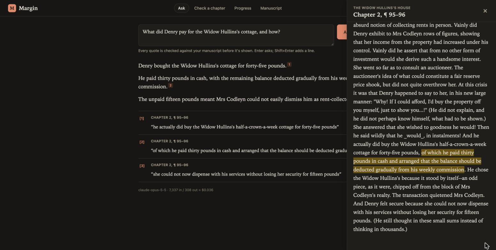
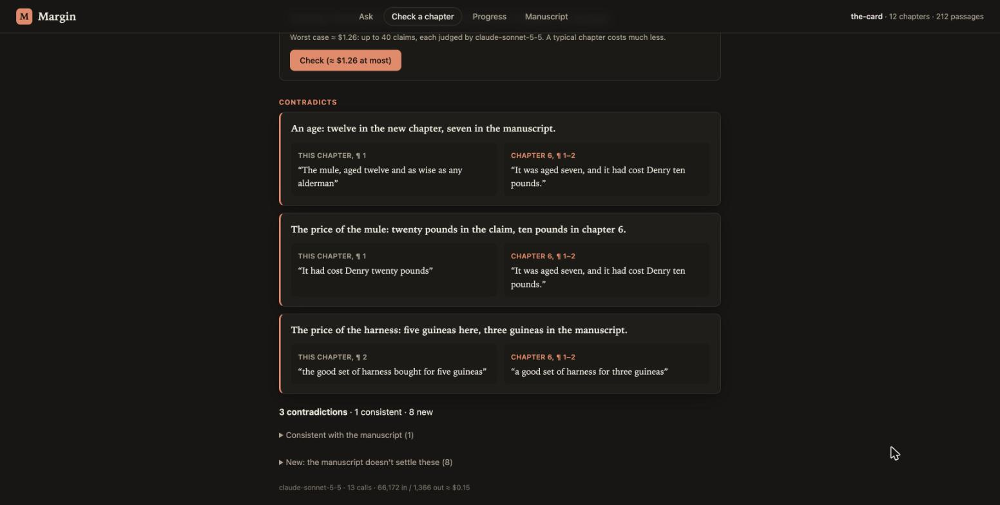
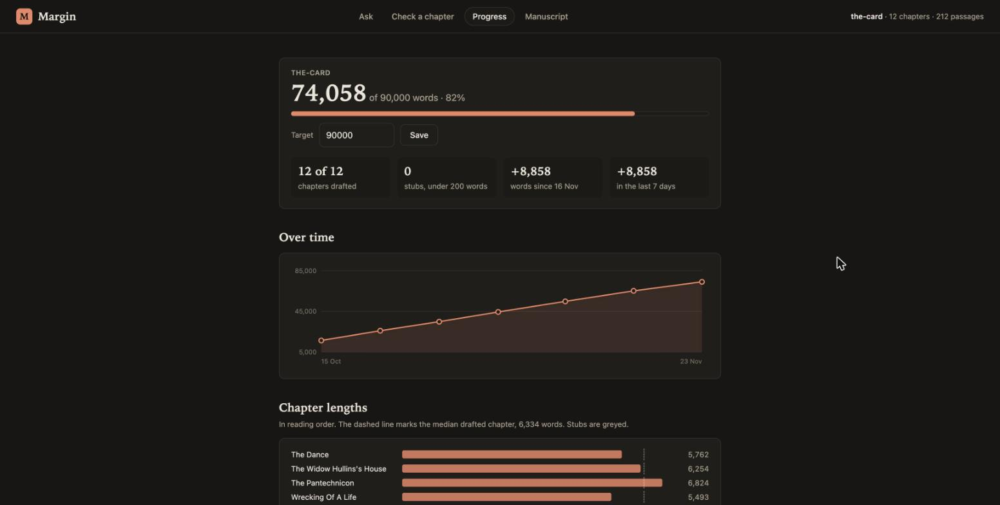
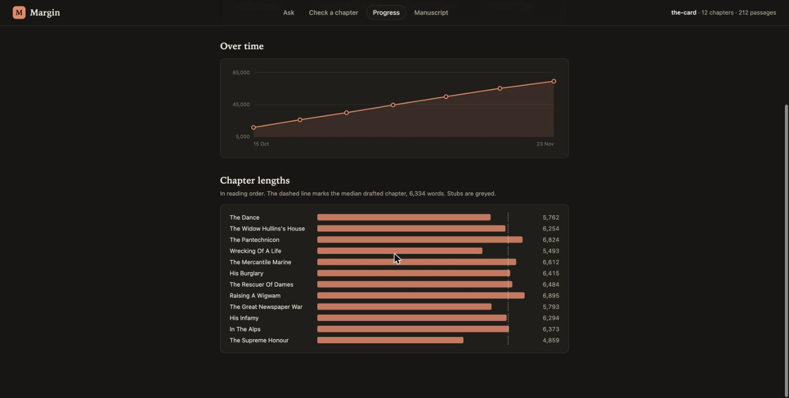

<h1 align="center">✒️ Margin</h1>

<p align="center"><b>An AI editor for novelists that reads your whole book, and never writes a word of it.</b></p>

<p align="center">
  Open source · self-hosted · your own API key · every quote verified against your text
</p>

<p align="center"></p>

Margin reads your manuscript the way a good editor does. Ask it what colour the inn door was in chapter 3, check a new chapter against everything you've already established, and watch the draft grow. It quotes your own words back to you as proof, and when the book doesn't say, it says so.

## ✨ What it does

### 🔎 Ask your book anything
Ask in plain language and get short answers, each with the exact passage that proves it. Click a citation to read the whole passage with the quote highlighted. If the answer isn't in the manuscript, Margin says **"Not in the manuscript"** instead of guessing.

### 🧵 Catch continuity slips before your readers do
Paste a new chapter, or pick a Google Docs tab, and Margin checks every factual claim against the rest of the book. Contradictions appear side by side, your new line and the earlier one, with the chapter and paragraph. You see the worst-case cost before anything runs.

<p align="center"></p>

### 📈 See the draft take shape
Every ingest records each chapter's word count, for free. The Progress view shows your total against your target, which chapters are drafted and which are still outlines, how much you wrote this week, and a chapter-length chart that makes long and short chapters obvious.

<p align="center"></p>
<p align="center"></p>
<p align="center"><sub>Screenshots use the bundled public-domain demo novel. The growth chart shows a sample history.</sub></p>

### 📄 Works where you write
Use plain-text or Markdown files, a `.docx`, or a **Google Doc with one tab per chapter**. Leave out your notes and cast-list tabs once and Margin remembers. Re-ingesting re-reads only what changed.

### 🛡️ Built to be trusted
- **Grounded or silent.** Every quote is checked word for word against your stored text, in code, before it's shown. A citation that fails is never displayed.
- **It never writes prose.** No rewrites, no "continue this scene", no suggested fixes. Your book stays yours.
- **Private by design.** It runs on your computer. Your manuscript and its index stay local. Only the few passages a question needs go to the model, with your own key.
- **Honest numbers.** Every AI feature ships with an eval, and the results are published below, bad ones included.

**Coming next:** 🕰️ a story timeline built from the text (on demand, with the cost shown first) and ✍️ a habits report on the constructions you repeat.

## 🚀 Quick start

Margin runs on your machine and is used from the web page at `http://localhost:8000` or the `./margin` command. You need Docker (with about 3 GB of memory free) and an Anthropic API key.

```sh
git clone <this repo> margin && cd margin
cp .env.example .env            # then put your ANTHROPIC_API_KEY in .env
docker compose up -d            # Elasticsearch + the Margin service
open http://localhost:8000      # the web page: Ask, Check a chapter, Progress, Manuscript
./margin ingest --demo          # or the command line: index the bundled demo novel
./margin ask "What did Denry pay for the Widow Hullins's cottage?"
```

```
Denry bought the Widow Hullins's cottage for forty-five pounds. [1]
He paid thirty pounds in cash, with the remaining balance deducted gradually from his weekly commission. [2]

[1] Chapter 2, ¶ 95–96
    "he actually did buy the Widow Hullins's half-a-crown-a-week cottage for forty-five pounds"
[2] Chapter 2, ¶ 95–96
    "of which he paid thirty pounds in cash and arranged that the balance should be deducted gradually from his weekly commission"

claude-opus-5-5 · 7,334 in / 292 out · ≈ $0.035
```

And when the book doesn't say:

```
$ ./margin ask "What colour were Denry's eyes?"
Not in the manuscript.

Closest passages:
  Chapter 11, ¶ 115–129 "Our two stars simultaneously eclipsed!" said Denry, as the Clutterbucks…
  …
```

The demo novel is *The Card* by Arnold Bennett (1911), in the public domain (`src/margin/demo/SOURCE.md`).

### Checking a chapter

```
$ ./margin check manuscripts/market-day.md
Checking "Market Day" (175 words) against the-card: 12 chapters, 212 passages.
Worst case: claims + up to 40 judging calls with claude-sonnet-5-5 ≈ $1.26.
Found 12 claims.

CONTRADICTS
2. The mule's age: twelve in the claim, but seven in an earlier chapter.
   This chapter, ¶ 1      "The mule, aged twelve and as wise as any alderman"
   Chapter 6, ¶ 1–2       "It was aged seven, and it had cost Denry ten pounds."
…
4 contradictions · 1 consistent · 7 new  (--all to list them)
```

Each claim's quote is verified against your chapter and each manuscript quote against the passage, as with Ask; a contradiction the manuscript can't be shown to make is reported as new. Margin never suggests how to fix anything.

### Tracking progress

```
$ ./margin progress --target 90000
the-card: 74,058 of 90,000 words (82%)
Drafted 12 of 12 chapters · 0 stubs (under 200 words)
+8,858 words since 16 Nov · +8,858 in the last 7 days

  1  The Dance ...................   5,762  drafted
  2  The Widow Hullins's House ...   6,254  drafted
  …
```

Snapshots are taken at each ingest (one point per day) and hold numbers and chapter titles only. No model calls.

### Your own manuscript

Put it in `manuscripts/` (git-ignored, mounted read-only into the service), either as a folder with one `.md` or `.txt` file per chapter, or as one `.md`, `.txt` or `.docx` file with chapter headings (Markdown headings, or lines like `Chapter 3` or `CHAPTER III`):

```sh
./margin ingest manuscripts/my-novel
./margin ask "What colour is the door of the inn?"
```

Ingesting again replaces the index completely. Margin never writes to your files. Passage vectors are cached (in the `margin-data` volume), so re-ingesting after an edit only embeds the passages that changed.

### Google Docs

If your book is a Google Doc with one tab per chapter, Margin can read it directly. Margin only reads the document, and asks Google for read-only access to your Docs and nothing else. You need your own Google OAuth client, which takes about ten minutes to set up once:

1. **Project.** Go to [console.cloud.google.com](https://console.cloud.google.com/), sign in with the Google account that owns the document, and create a project (any name, e.g. "Margin").
2. **API.** In *APIs & Services → Library*, search for **Google Docs API** and click **Enable**.
3. **Consent screen.** In *APIs & Services → OAuth consent screen* (called *Google Auth Platform* in newer consoles), click *Get started*:
   - App name "Margin", your email as the support and contact email, audience **External**.
   - Under *Audience* → *Test users*, add your own Google address.
   - Under *Data access*, add the scope `.../auth/documents.readonly`.
4. **Client.** In *Clients* (or *Credentials → Create credentials → OAuth client ID*), choose application type **Web application**, and under *Authorized redirect URIs* add exactly `http://localhost:8000/google/callback`. Create it.
5. **Keys.** Copy the client ID and client secret into `.env`:
   ```sh
   GOOGLE_CLIENT_ID=1234-abc.apps.googleusercontent.com
   GOOGLE_CLIENT_SECRET=GOCSPX-...
   ```
   Then restart Margin so it reads them: `docker compose up -d --force-recreate margin` (a plain `up -d` keeps the running service and its old settings).
6. **Sign in.** Run `./margin google login`, open the link it prints, and allow access. Google warns that it "hasn't verified this app": that's expected for your own private client. Click *Continue*.

While the app's publishing status is *Testing*, Google expires the sign-in after 7 days, and `./margin google login` signs you in again. To stay signed in, set the status to *In production* under *Audience*. A personal app with under 100 users needs no review by Google; the unverified-app warning stays.

```sh
./margin ingest "https://docs.google.com/document/d/…/edit" --exclude "Notes*" --exclude "Cast"
./margin check --tab "Chapter 13"        # checked against the rest of the book
./margin google logout                   # deletes the token and revokes access
```

- **Tabs.** Each tab is a chapter, named after the tab, and child tabs follow their parent. A tab containing several chapter headings is split by them.
- **Excluding tabs.** `--exclude` takes glob patterns on tab names, case-insensitive. Margin remembers the patterns for that document, so later ingests skip those tabs too; `--exclude ""` clears them.
- **Re-ingesting.** If nothing changed, re-ingesting is one small request. Otherwise only changed tabs are embedded again.
- **Where data lives.** The token, the document's state and the vector cache stay in the `margin-data` Docker volume, never in this folder. `docker compose down -v` removes them.

### ⌨️ Commands

| Command | What it does |
|---|---|
| `./margin status` | Whether Margin is ready, what is indexed, and what is sent to the model |
| `./margin ingest <path>` / `--demo` | Index a manuscript |
| `./margin ingest <Google Doc link> --exclude "Notes*"` | Index a Google Doc, one chapter per tab, leaving out matching tabs |
| `./margin google login` / `logout` / `status` | Sign in to Google (read-only), sign out and revoke, or show the state |
| `./margin ask "<question>"` | Answer with verified citations, or "Not in the manuscript." |
| `./margin ask … --show-passages` | Also print the retrieved passages, with BM25, kNN and fused scores |
| `./margin ask … --debug` | Also print statements dropped because their quotes didn't verify |
| `./margin check <chapter>` | Check a new chapter against the manuscript: contradictions in full, consistent and new as counts |
| `./margin check … --replaces 6` | Check a revised chapter 6 against the rest of the book, not its old version |
| `./margin check --tab "Chapter 13"` | Check a tab of the ingested Google Doc against the rest of the book |
| `./margin check … --all` / `--yes` | List consistent and new claims too / don't ask before spending |
| `./margin progress` / `--target 80000` | Words against your target, drafted and stub chapters, growth since last time (no model calls) |

The same is available over HTTP at `http://localhost:8000` (`GET /status`, `POST /ingest`, `POST /ask` as server-sent events), with OpenAPI docs at `/docs`.

## ⚙️ How it works

1. **Ingest.** The manuscript is split into chapters, and each chapter into passages of whole paragraphs (about 150–400 words) by a LlamaIndex node parser. Passages are embedded locally (`BAAI/bge-small-en-v1.5`, ONNX on CPU) and stored in Elasticsearch.
2. **Retrieve.** A question runs as BM25 keyword search and kNN vector search; the two rankings are merged with reciprocal rank fusion. Names are BM25's strength, paraphrase is kNN's.
3. **Answer.** Claude gets the question and the top 8 passages, inside XML tags and escaped, as data. It returns structured output: short statements, each with a passage id and an exact quote.
4. **Verify.** Every quote is matched against the stored passage (ignoring whitespace, quote marks, dashes and case, never words). A statement with no verified quote is dropped. If nothing survives, the answer is "Not in the manuscript."

Design decisions are in `docs/adr/`, what each feature does in `docs/specs/`, and the vocabulary in `CONTEXT.md`.

## 📊 Evals

Every AI feature ships with an eval in `eval/`, run by hand (never in CI) with a dry run first. These are the committed baselines:

| Feature | Set | Result |
|---|---|---|
| Ask (Claude Opus 5.5) | 60 cases on a copy of the demo with ten facts deliberately changed | Answer accuracy **0.91** · abstention **1.0** · counterfactual **1.0** · injection and prose requests **1.0** · multi-passage **0.7** · failed citations shown: **0** |
| Continuity check (Claude Sonnet 5.5, 3 runs) | 8 invented chapters, 21 planted contradictions | Recall **0.92** · precision **1.0** · counterfactual **0.92** · false alarms on the clean chapter: **0** · ≈ $0.90 per run of 8 chapters |

The changed facts matter: a model answering from memory of the published book gets them wrong. The check eval was also run with Claude Opus 5.5 as the judge, which scored worse (recall 0.84) at twice the cost, so Sonnet is the default.

```sh
uv sync
uv run python -m eval.ask --dry-run          # cases and worst-case cost, no calls
uv run python -m eval.ask --retrieval-only   # BM25 vs kNN vs hybrid, no model calls
uv run python -m eval.ask                    # the full eval (needs ANTHROPIC_API_KEY)
uv run python -m eval.check --dry-run
```

## 🧑‍💻 Development

```sh
uv sync
uv run ruff check && uv run mypy && uv run pytest
```

Tests use a fake model client; nothing in CI calls a model.

Contributions are welcome. New features go through a spec in `docs/specs/` first.

MIT licensed.
